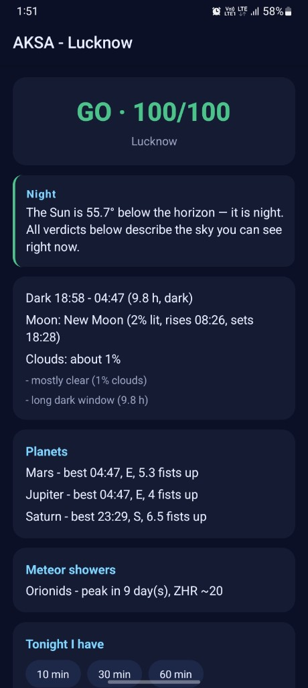
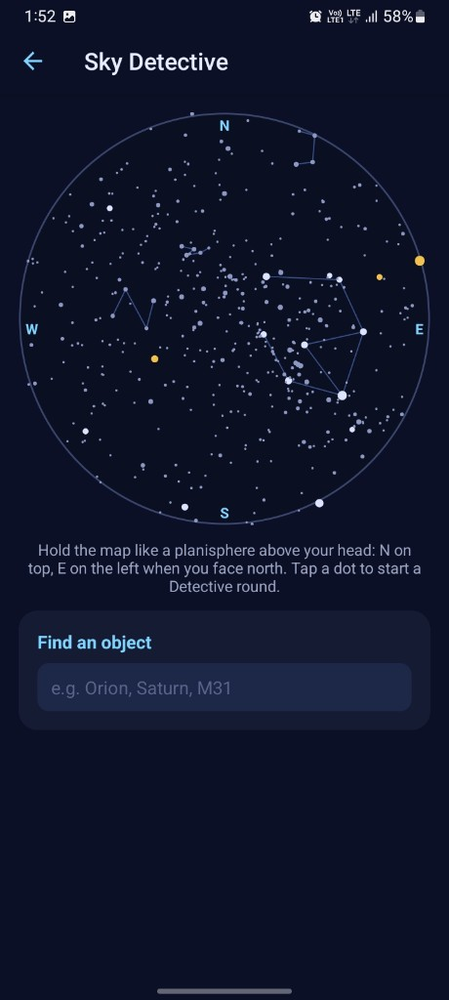
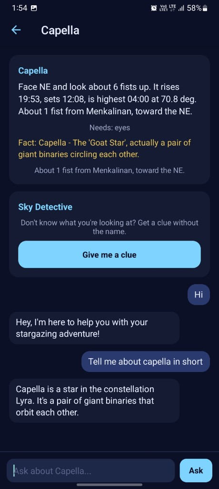
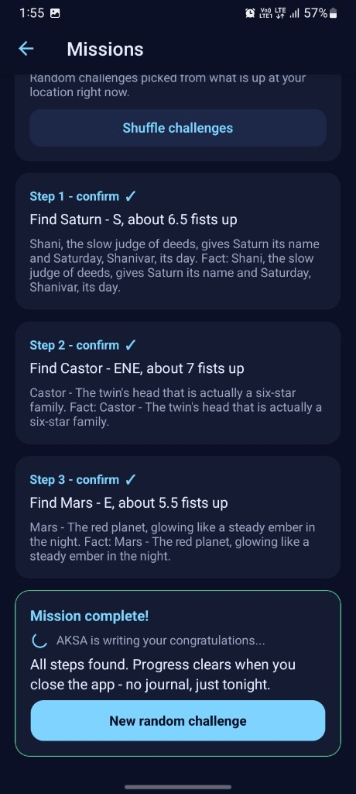
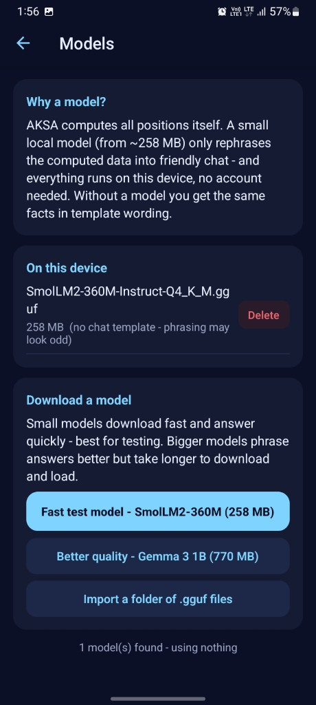

# 🌌 AKSA — Your Stargazing Buddy, Computed on Your Phone

**Know whether tonight is worth going out. Discover what's actually visible in your sky. Find it with directions you can follow using your own hands.**

AKSA is an offline-first, AI-powered stargazing companion that turns your phone into a personal guide to the night sky.

Unlike a generic AI astronomy chatbot, AKSA calculates astronomical positions on-device. Its local language model explains the results in friendly, natural language — it never invents celestial positions or decides what is visible from memory.

No account. No telemetry. Astronomy computed on your device.

## 📸 Screenshots

| Tonight Verdict | Sky Detective | Object + AI chat |
| --- | --- | --- |
|  |  |  |
| **Missions** | **Models** | |
|  |  | |

---

## ✨ Features

### 🌙 Tonight Verdict

Should you go stargazing tonight?

AKSA calculates a **GO / MAYBE / SKIP** recommendation using:

- Astronomical darkness, based on the Sun being below −18°.
- Real cloud-cover data.
- Moon phase and how long the Moon will be above the horizon.
- Active meteor showers and their observing conditions.

Every verdict comes with reasons you can inspect, rather than an unexplained AI-generated score.

### 🔭 Where Is It?

Ask AKSA about a star, planet, constellation, asterism, or Messier object.

Get useful observing information, including:

- Direction and altitude above the horizon.
- Approximate height in fists at arm's length — one fist represents roughly 10°.
- Rise and set times.
- Recommended observing equipment.
- Star-hopping hints using nearby bright stars.

AKSA uses your location and the current time to calculate the relevant sky information.

### 🧭 What's That Bright Object?

Not sure what you're looking at?

Describe the direction and approximate height above the horizon. AKSA searches its computed sky data for plausible candidates.

It uses astronomical calculations rather than asking the language model to guess what might be in the sky.

### 🕵️ Sky Detective

Explore a live all-sky map and tap objects to learn more about them.

When you need help finding an object, follow a five-stage clue ladder:

1. **Direction** — where to look.
2. **Star-hop** — which bright star to find first.
3. **Shape** — what pattern to recognize.
4. **Comparison** — how to distinguish the target.
5. **Reveal** — identify the object and explain what makes it interesting.

Clues are generated from verified catalog and sky-engine data, not from the model's unverified recollection.

### 🎯 Stargazing Missions

Turn a night outside into a series of small discoveries.

AKSA generates short observing challenges based on what's actually visible and the equipment available to you.

- Find objects that are currently observable.
- Follow practical, achievable observing steps.
- Get additional Detective clues when you get stuck.
- Explore the sky without needing to know astronomy beforehand.

### 💬 AI Chat

A general-purpose chat with the loaded on-device model — talk about the sky or anything else, with streaming replies and a clear-chat button. Unlike the Guide, it is not grounded in tonight's computed plan, so it can wander freely. History is memory-only and resets when the app closes.

### 🤖 On-Device AI

AKSA uses a local GGUF language model through `llama.rn` and `llama.cpp`, with two download options on the Models screen:

- **Fast test model** — `SmolLM2-360M-Instruct-Q4_K_M.gguf`, about 258 MB. Quick to download and snappy on budget phones.
- **Better quality** — `gemma-3-1b-it-Q4_K_M.gguf`, about 770 MB. Nicer phrasing, slower on low-end devices.

Downloaded and imported models **load into the AI runtime automatically** — the status line confirms when the model is live.

The model has three primary responsibilities:

1. **Route questions** to the appropriate application capability.
2. **Explain computed results** in friendly, natural language.
3. **Handle casual conversation** without pretending to see the sky or fabricate astronomical facts.

If no model is installed, AKSA falls back to template-based responses. The core astronomy experience remains available without requiring a hosted language-model API.

---

## 🧠 How the AI Works

AKSA separates astronomical computation from language generation.

```text
User question
     │
     ▼
Intent routing
     │
     ▼
On-device astronomy engine
     │
     ├── Object positions
     ├── Rise and set times
     ├── Visibility calculations
     ├── Weather and Moon conditions
     └── Catalog and observing data
     │
     ▼
Local language model
     │
     ▼
Friendly explanation grounded in computed results
```

The astronomy engine is the source of truth. The local model helps interpret the user's intent and communicate results; it does not determine celestial positions from its training data.

When the model is unavailable, deterministic application logic and response templates provide a fallback.

**The principle is simple: calculate the sky, then explain it.**

---

## 🔒 Privacy by Construction

AKSA is designed around local computation and minimal data collection.

- **No account required.** There is no sign-up flow.
- **Location in memory.** GPS coordinates are used during the session and are not intentionally persisted by the app. If GPS is unavailable, you can select a city.
- **No persisted personal app state.** Chat history, profile settings, clue progress, and mission progress reset when the app closes.
- **No analytics or telemetry.** AKSA does not intentionally send usage analytics to a tracking service.
- **Local AI inference.** Once the model is downloaded, text generation runs on the device.
- **Minimal network dependencies.** Open-Meteo supplies cloud-cover data, and an optional IP-location fallback can use ipapi.co when GPS is unavailable. Downloading a GGUF model also requires an internet connection.

Weather requests require sending the relevant location to the weather service. The IP-location fallback communicates with its provider when used.

The model download is optional for the template-only experience, although model-based responses require a compatible model installed on the device.

---

## 🛠️ Tech Stack

| Component                 | Technology                                                         |
| ------------------------- | ------------------------------------------------------------------ |
| Mobile application        | React Native, Expo, TypeScript                                     |
| Navigation                | Expo Router                                                        |
| Local AI integration      | `llama.rn`                                                         |
| Inference engine          | `llama.cpp`                                                        |
| Model format              | GGUF                                                               |
| Default models            | SmolLM2 360M (fast, 258 MB) / Gemma 3 1B (quality, ~770 MB), Q4_K_M |
| State management          | Zustand, without persistence                                       |
| Astronomy engine          | Pure TypeScript port of the original Python astronomy calculations |
| Weather data              | Open-Meteo                                                         |
| Testing                   | Unit tests and golden fixtures against a Python reference          |

---

## 🚀 Getting Started

### Prerequisites

- [Bun](https://bun.sh/) 1.4.0
- [Node.js](https://nodejs.org/) 20 or later for Expo tooling
- An Android device or compatible emulator
- A custom Expo development build or standalone APK for native `llama.rn` support

Expo Go alone does not include arbitrary native modules such as `llama.rn`.

### Install dependencies

Clone the repository and enter the project directory:

```bash
git clone https://github.com/YashChandra141/AKSA-mobile.git
cd AKSA-mobile
```

Install dependencies:

```bash
bun install
```

Follow the repository's native setup instructions if the `llama.rn` native artifacts need to be downloaded separately.

### Run the application

Use the scripts defined in `package.json`. If the project defines the following scripts:

```bash
bun run android
bun run test
bun run typecheck
```

- `android` launches the configured Android development workflow.
- `test` runs the project's test suite.
- `typecheck` runs TypeScript checks.

A native development build is required for testing the full local-AI integration.

### Build an Android APK (release, standalone)

The debug build loads its JavaScript from Metro, but a release APK is fully
self-contained — install it once and the phone needs nothing else:

```bash
cd android
.\gradlew assembleRelease
```

The APK is written to `android/app/build/outputs/apk/release/aksa.apk`
(the release APK is renamed to `aksa.apk` at build time). The build targets
arm64 only (`reactNativeArchitectures` in `gradle.properties`) and caps
parallel compile workers, since llama.cpp translation units need 1 GB+ of RAM
each. A rebuild after a change is quick — gradle caches all native
compilation.

### Build with EAS (alternative)

AKSA can also be built remotely using Expo Application Services (EAS),
avoiding local Android Gradle compilation.

Configure your EAS build profiles in `eas.json`, then run:

```bash
bunx eas-cli login
bunx eas-cli build:configure
bunx eas-cli build --platform android --profile preview
```

Note: the free EAS plan caps builds at 45 minutes, which this project's
native C++ (llama.cpp) can exceed — the local build above is the proven
path. Make sure the selected profile specifies an APK build using
`android.buildType: "apk"`. After the build completes, download the APK from
the Expo build dashboard and install it on your Android device.

Cloud compilation does not eliminate the need to test native inference on a real device.

---

## 🧩 Installing the AI Model

Pick a model on the **Models** screen:

1. Open **Models** and download the **fast test model** (`SmolLM2-360M-Instruct-Q4_K_M.gguf`, ~258 MB) or the **better quality** model (`gemma-3-1b-it-Q4_K_M.gguf`, ~770 MB) over Wi-Fi — or import a compatible GGUF you already have.
2. The model **loads automatically** once downloaded — the status line says "ready — AI answers are live."
3. Ask a question and receive a response from the local model.

Model availability, memory usage, and inference speed depend on the device and the model's compatibility.

If no model is installed, AKSA uses its template-only fallback.

---

## 📁 Project Structure

```text
src/
├── app/          # Expo Router screens
│   ├── Tonight
│   ├── Guide
│   ├── Chat
│   ├── Detective
│   ├── Missions
│   ├── Models
│   └── Object
├── sky/          # Deterministic astronomy logic
│   ├── astro
│   ├── catalog
│   ├── score
│   ├── facts
│   ├── intent
│   ├── skyQuery
│   ├── mapData
│   ├── clues
│   └── missions
├── ai/           # Local inference and AI orchestration
│   ├── prompts
│   ├── llm runtime
│   ├── router
│   └── model manager
├── services/     # Location and weather
└── state/        # In-memory Zustand state

tests/             # Unit tests and golden fixtures
tools/             # Fixture generation and maintenance
```

---

## 🧪 Testing and Accuracy

The sky engine is intended to preserve the behavior of the original Python AKSA CLI through a TypeScript implementation.

The suite — 105 tests across 4 files — runs golden fixture comparisons against the Python reference across multiple observing locations and seasons, including Pune in autumn, Reykjavík in summer, and New York in winter.

The stated comparison tolerances are:

- **Angular positions:** within 0.5°.
- **Rise and set times:** within 5 minutes.

These are test targets for the reference comparisons, not a guarantee of accuracy for every object, location, or observing condition.

Run the project's test suite and type checks before contributing changes:

```bash
bun run test
bun run typecheck
```

---

## 🌌 Design Philosophy

AKSA is built around three principles:

**1. Computation over hallucination**

Astronomical positions and visibility are calculated from data and algorithms, not generated by a language model.

**2. Local-first AI**

The model runs on the phone, reducing reliance on remote AI services and keeping conversational processing on-device.

**3. Discovery over complexity**

Astronomy should be approachable. Directions, fist measurements, star-hopping hints, clues, and missions help newcomers explore without needing specialist equipment or prior knowledge.

---

## 📚 Attribution

- **Astronomy calculations:** [Astronomy Engine](https://github.com/cosinekitty/astronomy) and the original AKSA Python reference implementation.
- **Weather:** [Open-Meteo](https://open-meteo.com/).
- **On-device inference:** [llama.cpp](https://github.com/ggml-org/llama.cpp).
- **React Native integration:** [llama.rn](https://github.com/mybigday/llama.rn).
- **Language model:** [Gemma](https://ai.google.dev/gemma), with quantized GGUF model distribution.
- **Astronomical catalogs:** HYG star catalog and Messier object data bundled from the original AKSA project.

Please consult the respective projects' licenses and attribution requirements when redistributing their data or model files.

---

## 🤝 Contributing

Contributions, bug reports, and ideas are welcome.

Areas where contributions are especially useful include:

- Astronomy-engine accuracy and test coverage.
- New observing challenges and clue strategies.
- Better model compatibility and memory management.
- Accessibility and usability improvements.
- Documentation and reproducible build instructions.

Please include tests for changes to deterministic astronomy logic whenever practical.

---

## 📄 License

See the repository's `LICENSE` file for the project's licensing terms.

---

**AKSA — The sky is computed. The wonder is yours.** 🌠
